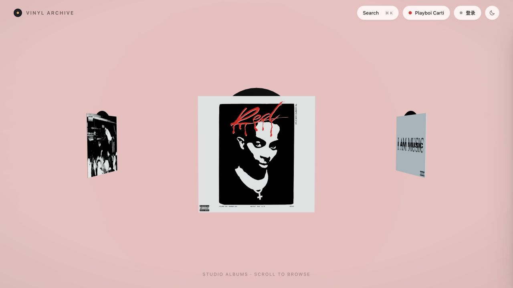
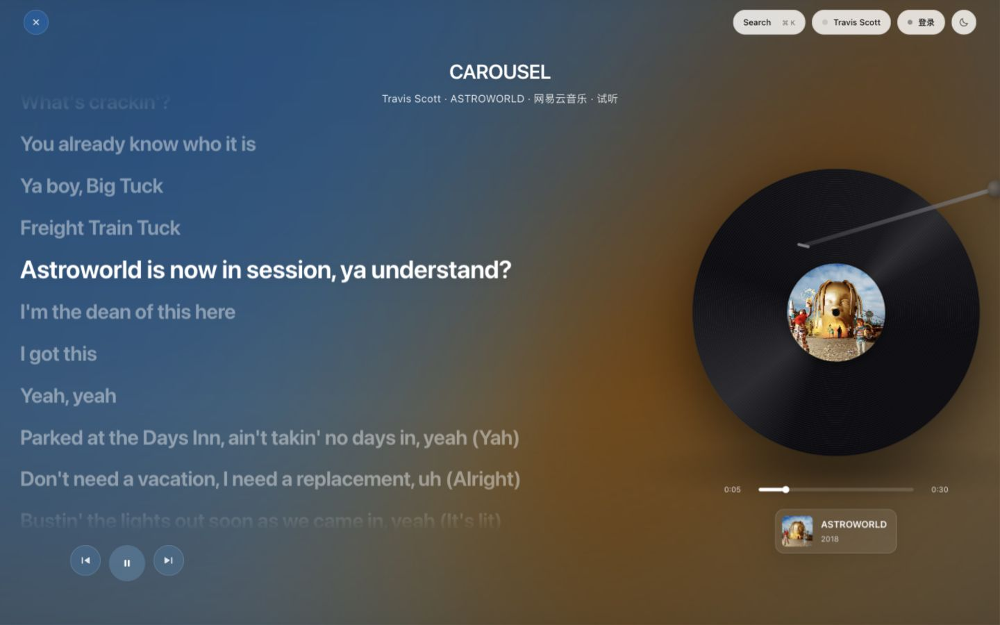

# Vinyl Archive · 黑胶馆

以黑胶唱片为灵感的音乐播放器，支持 **Windows、macOS 与网页部署**。保留完整专辑封面，用悬停抽出、滑回胶套和原位翻面来浏览音乐。

[下载桌面版](https://github.com/Justinchengpepe/music-player/releases/latest) · [网页版展示](https://justinchengpepe.github.io/music-player/) · [Codespaces 体验](https://codespaces.new/Justinchengpepe/music-player)

## 下载与安装

桌面安装包自带运行环境，**不需要安装 Node.js 或打开终端**。

| 设备 | v1.1.0 下载 |
|---|---|
| Windows 10 / 11，Intel / AMD 64 位 | [Windows 安装程序 · EXE](https://github.com/Justinchengpepe/music-player/releases/download/v1.1.0/Vinyl-Archive-1.1.0-win-x64.exe) |
| Apple 芯片 Mac（M 系列），macOS 13+ | [Apple 芯片 · DMG](https://github.com/Justinchengpepe/music-player/releases/download/v1.1.0/Vinyl-Archive-1.1.0-mac-arm64.dmg) · [ZIP](https://github.com/Justinchengpepe/music-player/releases/download/v1.1.0/Vinyl-Archive-1.1.0-mac-arm64.zip) |
| Intel Mac，macOS 13+ | [Intel · DMG](https://github.com/Justinchengpepe/music-player/releases/download/v1.1.0/Vinyl-Archive-1.1.0-mac-x64.dmg) · [ZIP](https://github.com/Justinchengpepe/music-player/releases/download/v1.1.0/Vinyl-Archive-1.1.0-mac-x64.zip) |

**Windows**：运行 EXE，按向导安装。关闭窗口会退出应用。

**Mac**：打开 DMG，将 Vinyl Archive 拖入「应用程序」；或解压 ZIP 后移动 App。关闭窗口后继续播放，点击 Dock 图标可重开，`⌘Q` 完全退出。

当前安装包没有商业代码签名，Mac 未做 Apple 公证，系统可能提示未知开发者。确认来自本仓库后，按系统提示操作；Mac 可在「系统设置 → 隐私与安全性」查看被拦截的应用。发布页提供 [SHA256SUMS.txt](https://github.com/Justinchengpepe/music-player/releases/download/v1.1.0/SHA256SUMS.txt)，可核对安装包校验值。

## 界面





## 功能

- **黑胶馆**：薄胶套保留完整封面，上沿微露黑胶；悬停抽出，移开滑回。选中专辑后，大封面原位翻面查看曲目。
- **精选与全库搜索**：内置欧美说唱 / R&B 歌手精选；`⌘K` / `Ctrl+K` 搜索网易云歌手与专辑，搜索结果可重复选择。
- **正式专辑筛选**：优先正式录音室专辑，排除单曲、EP、现场、混音、精选及重复版本；专辑较多时自动留出间距。
- **流动背景**：从当前专辑封面提取配色，播放时缓慢流动；暂停后静止，尊重系统的减少动态效果设置。
- **同步歌词**：时间轴高亮、滚动与重试，适配试听起始偏移。
- **沉浸播放**：播放页闲置 4 秒后隐去控制，移动鼠标或触碰唤回；键盘操作、暂停和弹窗期间保持控制可见。
- **启动动画、明暗主题与触屏布局**。

## 音乐来源与账号

| 平台 | 当前可用范围 |
|---|---|
| 网易云音乐 | 扫码登录、曲库、歌词与按账号权益返回的播放地址；部分歌曲可能仅试听或不可播放 |
| Apple Music | 已有账号入口与 MusicKit 适配；实际播放需要开发者配置、用户授权、订阅及受支持的播放环境 |
| Spotify | 已有 PKCE 登录与设备控制适配；需要开发者应用、相应授权、Premium 和可用的活动设备 |
| QQ 音乐 | 桌面版打开隔离的官方网页会话；当前没有本地播放适配 |

四个平台入口不代表四个平台都已完成本地播放聚合。默认自动播放使用本地可用来源，不会自动让 Spotify 在其他设备播放，也不会用公开试听冒充完整音源。

账号保存在用户自己的浏览器或桌面应用数据中，不随安装包分发。开发者配置可参考 [music-services.example.json](music-services.example.json)；桌面配置位于应用用户数据目录，网页部署可在项目目录创建 `music-services.json`。不要提交账号 Cookie、私钥或实际配置文件。

## 网页版

[GitHub Pages 展示页](https://justinchengpepe.github.io/music-player/) 展示界面与使用方式。真正播放需要 Node 服务，不能只把播放器 HTML 上传到静态托管。

```bash
git clone https://github.com/Justinchengpepe/music-player.git
cd music-player
npm ci
npm start
```

浏览器打开 `http://localhost:8088`。仅部署网页时可使用 `npm ci --omit=dev`，无需下载 Electron。

也可点击 [Codespaces](https://codespaces.new/Justinchengpepe/music-player) 在云端运行。首次启动需要下载安装依赖与读取曲库，完成后从端口面板打开 8088。

### 服务器部署

仓库保留 [deploy.sh](deploy.sh) 与 [.railwayignore](.railwayignore)，可沿用已有 Ubuntu / PM2 或 Railway 部署。

| 环境变量 | 说明 |
|---|---|
| `PORT` | 网页监听端口，默认 `8088` |
| `HOST` | 网页默认 `0.0.0.0`；桌面版固定为 `127.0.0.1` |
| `NETEASE_PROXY` | 可选的网易云接口请求代理 |
| `VINYL_DESKTOP_TOKEN` | 桌面进程自动生成的本地请求令牌，网页部署不需要设置 |

## 从源码开发与打包

建议 Node.js 22。网页运行与桌面版共用 `index.html`、`server.js` 和 `lib/`，无需前端构建。

```bash
npm ci
npm run desktop              # 启动桌面应用
npm test                     # 自动检查
npm run desktop:smoke        # 桌面启动检查
```

在对应操作系统上构建：

```bash
npm run build:win            # Windows x64 安装程序
npm run build:mac:arm64      # Apple 芯片 Mac：DMG + ZIP
npm run build:mac:x64        # Intel Mac：DMG + ZIP
npm run build:mac:dir        # 仅生成本机 Mac .app，供调试
```

输出位于 `dist/`。Windows 安装包应在 Windows 上构建，Mac 安装包在 macOS 上构建。可用 `npm run desktop:smoke:package -- arm64` 检查已打包的 Apple 芯片应用；Windows 和 Intel Mac 使用 `x64`。

### 自动发布

[GitHub Actions](https://github.com/Justinchengpepe/music-player/actions/workflows/release.yml) 会先运行测试，再分别生成 Windows、Apple 芯片 Mac、Intel Mac 安装包并验证应用启动。Intel 二进制在预装 Rosetta 的 Apple 芯片运行器上验证，避免云端 Intel 虚拟显卡无法启动 WebGL。三个平台全部通过后，才生成校验值并发布到 GitHub Releases。

后续发布：更新 `package.json`、`package-lock.json` 中的版本号与 `RELEASE_NOTES.md`，推送到 `main`。也可从 Actions 手动运行同一工作流。安装包不提交到源码仓库。

## 添加歌手

```bash
npm run add-artist "Frank Ocean"
npm run add-artist --list
```

精选入口保存在 `artists.json`；搜索不受精选名单限制。封面通过网易云与 Apple 的图片服务匹配，是否返回数据取决于平台接口。

## 主要目录

```text
index.html                    播放器界面与 3D 黑胶场景
server.js / lib/              本地服务、音乐来源与歌词
js/                           搜索、播放、账号、歌词、动画模块
assets/                       样式与启动页
artists.json                  精选歌手
build/                        桌面图标
desktop/                     Electron 主进程、预加载与后端入口
scripts/                      歌手维护、安装包验证与校验值生成
tests/                        自动检查
docs/                         已有 GitHub Pages 展示页
.github/workflows/release.yml  三平台构建与发布
```

更多实现记录见 [research/MACOS-PLAYER.md](research/MACOS-PLAYER.md)。

## 许可与说明

源码使用 [ISC 许可](LICENSE)。音乐、封面、歌词与平台账号能力由相应服务提供，版权属于原权利人；本项目不提供或分发歌曲文件，不绕过平台付费或授权限制。
